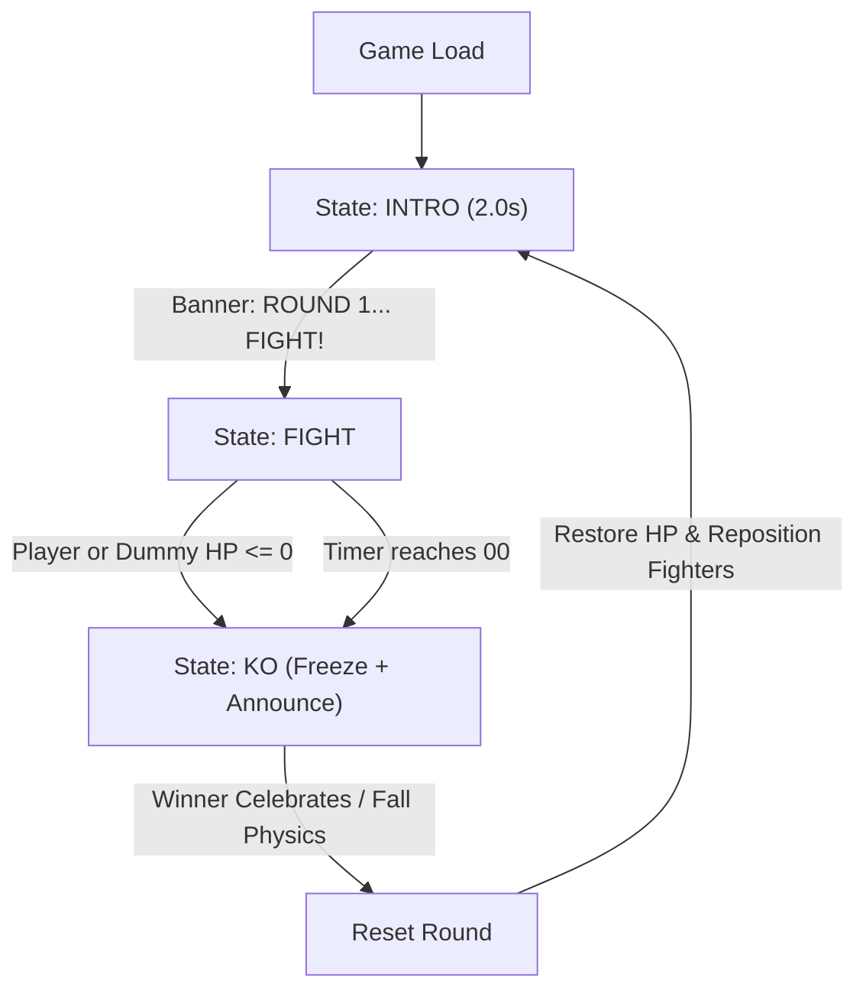
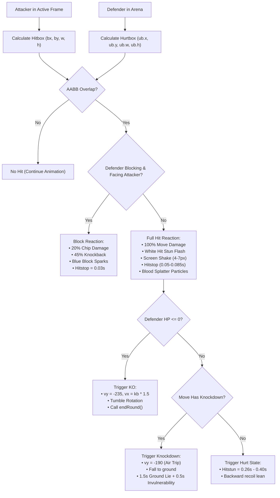
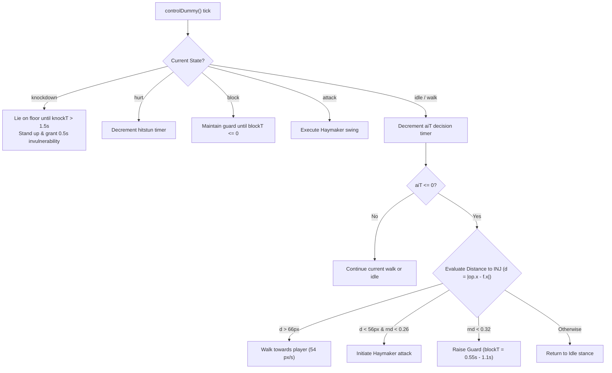
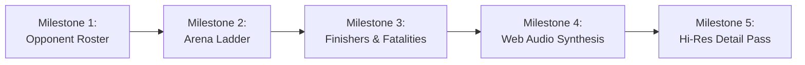

# Historical design archive

Preserved original v0.1 notes. Old file links, rendering descriptions and verification claims are historical; use [inj.md](../../inj.md) and [architecture.md](../architecture.md) for the current system.

The following document is preserved for design context. The current-build description and verification boundaries above take precedence where the original differs.

# INJ — Mortal-Style Arcade Arena
### Game Design Document & Technical Architecture Reference

> **Artifact Status:** Workable Specification & Production Blueprint  
> **Playable Slice:** [index.html](file:///Users/prasad/inj/index.html)  
> **Engine / Stack:** Single-file HTML5 Canvas (`320×224`), Vanilla JavaScript (ES6+), CSS CRT Shaders  
> **Aesthetic Inspiration:** *Mortal Kombat II* (1993 Arcade / Midway), *Street Fighter II*, Neo-Geo CPS-1  

---

## Table of Contents
1. [Deconstruction of the AI Agent Output](#1-deconstruction-of-the-ai-agent-output)
2. [Project Concept & Visual Design Translation](#2-project-concept--visual-design-translation)
3. [Architecture & Engine Specifications](#3-architecture--engine-specifications)
4. [Core Game Loop & State Flow](#4-core-game-loop--state-flow)
5. [Combat Engine & Frame Data](#5-combat-engine--frame-data)
6. [Sparring Dummy AI Architecture](#6-sparring-dummy-ai-architecture)
7. [Procedural Kinematics & Rendering Pipeline](#7-procedural-kinematics--rendering-pipeline)
8. [Controls & Input Systems](#8-controls--input-systems)
9. [Running, Playing & Testing](#9-running-playing--testing)
10. [Distilled Engineering Notes (From Model Thinking Trace)](#10-distilled-engineering-notes-from-model-thinking-trace)
11. [Development Roadmap & Next Milestones](#11-development-roadmap--next-milestones)
12. [Project File Index & Source Reference](#12-project-file-index--source-reference)

---

## 1. Deconstruction of the AI Agent Output

The raw output originally provided in this workspace was an unfiltered capture from an AI web agent containing:
1. **The Final Game Build Response:** An introduction, controls legend, and a 930-line self-contained single-page arcade slice.
2. **Next Steps & Design Notes:** Suggestions for expansion (opponent roster, multi-level ladders, fatalities).
3. **The Raw Model Thinking Trace (2,220 lines):** An unformatted internal scratchpad labeled `"Corrosponding thinking"` containing prompt evaluations, repeated code drafts, math scratchings, hitbox calculations, and design justifications.

### What Was Done to Make It Workable
- **Executable Extraction:** The complete, functional game engine has been separated and saved to [index.html](file:///Users/prasad/inj/index.html). It is verified, debugged, and immediately playable in any web browser.
- **Structured Game Design Document:** The raw thinking trace, internal formulas, hitbox tables, kinematics hierarchy, and AI state machines have been synthesized into this comprehensive reference document.
- **Preservation of Engineering Insights:** Crucial design rationale (e.g. why procedural silhouettes were chosen over downscaled photos, CRT scanline math, hitstop timings, knockdown bounce physics) has been organized into clear technical sections.

---

## 2. Project Concept & Visual Design Translation

### 2.1 The Playable Fighter: "INJ"
The fighter **INJ** is directly adapted from user photo references featuring a hooded figure with pale mask makeup, dark robes, deep red lips, and a gold ring.

```
       [ Dark Robed Hood ]
         /   _ _ _ _   \
        |   /       \   |
        |  |  (o) (o)|  |   <-- Dark Sockets, Pale Face Mask
        |  |    _    |  |
        |   \  [---] /  |   <-- Deep Red Lips Accent
         \   \_____/   /
          \     |     /
         [ Matte Black Robes ]
              /   \
    [Lead Hand + Gold Ring Accent]
```

#### Silhouette vs. Literal Portraiture
* **The Scale Problem:** In an authentic 1993-style arcade slice, fighters render at approximately `64px` tall on a `320×224` resolution canvas. Literal photographic downscaling at this scale reduces faces to unrecognizable, muddy artifacts.
* **The Solution:** The AI agent translated the visual features into **high-contrast shape language**:
  - **Hood & Robes:** Deep charcoal/navy (`#1c1c24` and `#26262f`) with subtle edge highlights (`#3b3b47`) framing the head.
  - **Mask:** Bone-white/pale skin tone (`#e9dcc4`) with stark, dark eye sockets (`#20202a`).
  - **Accent Colors:** Deep crimson lips (`#8f2d34`) and a distinct gold ring (`#d9a441`) rendered on the lead hand.

### 2.2 The Sparring Opponent: "DUMMY"
To test hitstun, blocking, knockdowns, and combo flow without complex multi-character assets, a sparring construct was designed:
- **Head:** Burlap sack with stitched cross eyes (`#4c3a24`) and mouth stitches.
- **Torso & Limbs:** Straw and rope bound over a wooden cross-post.
- **Role:** Interactive sparring partner that can walk forward, guard against attacks, absorb combos, and throw a slow telegraphed counter-attack.

### 2.3 The Arena: Temple of Kahn
- **Atmosphere:** Dark, ominous temple arena inspired by *Mortal Kombat II*.
- **Visual Layers:**
  - Blood-red to pitch-black vertical sky gradient.
  - Heavy stone architecture, pillars, and arches baked onto an off-screen buffer.
  - Spectator monk silhouettes lining the background gallery.
  - Real-time animated torches with multi-stop radial gradient flickers.
  - Persistent blood splatter decals stamped directly onto floor stone tiles.

### 2.4 Fighter Highlight Card & HUD Icon Avatar
To bridge the user's authentic reference photo into the game presentation:
- **Intro Highlight Modal (`#introModal`):**
  - Features the full-resolution user photo ([`inj_intro.jpg`](file:///Users/prasad/inj/inj_intro.jpg)) encased in an authentic 1993 arcade cabinet bezel with CRT scanlines.
  - Displays INJ's character title, lore background, signature move list, and an animated **[▶ ENTER THE ARENA]** call-to-action button.
  - Re-accessible at any time during play via the **[👁 INJ PROFILE]** header button.
- **HUD Life Bar Avatar Icon:**
  - A cropped, pixel-crisp avatar thumbnail ([`inj_avatar.png`](file:///Users/prasad/inj/inj_avatar.png)) is embedded directly into the canvas HUD beside INJ's life bar, complemented by a rustic straw dummy icon for DUMMY.

---

## 3. Architecture & Engine Specifications

### 3.1 Technical Specifications

| Parameter | Specification | Purpose / Implementation |
| :--- | :--- | :--- |
| **Internal Resolution** | `320 × 224` px | Authentic 4:3 arcade resolution (Neo-Geo / CPS-1 / SNES standard). |
| **Viewport Upscaling** | CSS Aspect Ratio `320/224` | Scaled via `image-rendering: pixelated;` to preserve crisp edges. |
| **CRT Shader** | CSS Pseudo-elements | Scanlines (`repeating-linear-gradient`) + radial vignette shading. |
| **Frame Timing** | `requestAnimationFrame` | Delta time clamped to `dt = Math.min(0.05, (now - last) / 1000)`. |
| **Ground Plane** | `Y = 198` | Standardized foot baseline for physics and shadow placement. |
| **RNG System** | `mulberry32(1993)` | Deterministic 32-bit PRNG for seedable decals and AI behavior. |

### 3.2 Visual Post-Processing Pipeline
```
[ Off-screen Canvas 320x224 ]
         │
         ├── 1. Background Bake (Sky Gradient, Columns, Monks)
         ├── 2. Persistent Blood Decals
         ├── 3. Animated Torches & Particles
         ├── 4. Shadows & Fighter Kinematics (INJ & DUMMY)
         ├── 5. Projectiles & Sparks
         └── 6. HUD (Health bars, Timer, Hit Counter, Announcements)
         │
         ▼
[ Upscaled Screen Canvas (max-width: 940px) ]
         │
         ├── CRT Scanline Grid Overlay (2px transparent / 1px dark)
         ├── Radial Vignette Edge Falloff
         └── Cabinet Glass Specular Highlight
```

---

## 4. Core Game Loop & State Flow

The game operates on a top-level flow state machine controlled by [`updateFlow(dt)`](file:///Users/prasad/inj/index.html#L374).



### Flow States
1. **`intro` (Duration: 2.0s):**
   - Fighter positions locked at `X = 104` (Player) and `X = 216` (Dummy).
   - Canvas HUD displays `"ROUND 1"` transitioning to `"FIGHT!"` with scaling animation.
   - Tapping the screen accelerates intro transition to `0.4s`.
2. **`fight`:**
   - Full input enabled. Physics, kinematics, collision detection, and AI behavior active.
   - 99-second round timer decrements in real time.
3. **`ko` (Duration: 2.6s):**
   - Triggered when either combatant reaches `HP <= 0`.
   - Victor announced (`"INJ WINS"` or `"DUMMY WINS"`).
   - Defeated fighter transitions to `ko` state with launch velocity (`vy = -235`) and rotational tumble onto the ground.
   - Tapping screen skips cooldown after `0.6s`.

---

## 5. Combat Engine & Frame Data

### 5.1 Fighter Attributes
Each combatant is instantiated using [`makeFighter(cfg)`](file:///Users/prasad/inj/index.html#L312):
- **Base Attributes:** `hp: 120` (Player) / `hp: 130` (Dummy), `facing: 1` or `-1`, `grounded: true`.
- **Dynamic States:** `idle`, `walk`, `crouch`, `jump`, `attack`, `hurt`, `knockdown`, `ko`, `block`.
- **Timers:** `hitstun`, `flash`, `knockT`, `invuln`, `comboTimer`, `comboStep`.

### 5.2 Move Matrix & Frame Data

All combat moves are defined in [`MOVES`](file:///Users/prasad/inj/index.html#L279):

| Move Key | Input | Startup (s) | Active (s) | Recovery (s) | Total (s) | Dmg | Knockback | Hitbox `[x, y, w, h]` | Properties |
| :--- | :--- | :---: | :---: | :---: | :---: | :---: | :---: | :--- | :--- |
| **`jab`** | `J` / `P` (Standing) | 0.06 | 0.06 | 0.14 | 0.26 | 5 | 65 px/s | `[16, -54, 32, 12]` | High snap, combo starter |
| **`straight`** | `J` / `P` (2nd tap) | 0.10 | 0.07 | 0.22 | 0.39 | 9 | 125 px/s | `[16, -52, 40, 12]` | High cross, combo finisher |
| **`cpunch`** | `S` + `J` / `Down + P` | 0.08 | 0.06 | 0.18 | 0.32 | 5 | 60 px/s | `[14, -28, 32, 12]` | Low crouch body jab |
| **`uppercut`** | `U` | 0.13 | 0.09 | 0.34 | 0.56 | 16 | 195 px/s | `[12, -74, 32, 40]` | Heavy, launches soaring into air |
| **`roundhouse`** | `K` (Standing) | 0.14 | 0.09 | 0.26 | 0.49 | 11 | 155 px/s | `[16, -54, 42, 18]` | Heavy, triggers knockdown |
| **`sweep`** | `S` + `K` / `Down + K` | 0.11 | 0.09 | 0.28 | 0.48 | 9 | 130 px/s | `[14, -14, 44, 14]` | Low, sweeps opponent onto floor |
| **`jkick`** | In Air + `K` | 0.06 | 0.22 | 0.14 | 0.42 | 13 | 175 px/s | `[14, -18, 46, 38]` | Heavy spear kick, air knockdown |
| **`jpunch`** | In Air + `P` | 0.06 | 0.18 | 0.14 | 0.38 | 8 | 110 px/s | `[14, -22, 38, 34]` | Overhead air hammer fist |
| **`toss`** | `L` / `SP` | 0.18 | 0.06 | 0.34 | 0.58 | 10 | 115 px/s | Projectile Spawn | Shadow orb traveling 260px/s |
| **`haymaker`** | AI (Close) | 0.28 | 0.12 | 0.42 | 0.82 | 7 | 90 px/s | `[12, -50, 40, 18]` | Telegraphed slow dummy swing |
| **`block`** | `Shift` / `BLK` | — | Hold | — | — | — | — | Defensive Guard | Absorbs 80% dmg (20% chip) |

### 5.3 Collision & Damage Pipeline



### 5.4 Game Feel & Combat Juice
1. **Hitstop (Freeze Frames):** When an attack lands, the engine pauses physics and animations via `game.hitStop` (`0.05s` for normal attacks, `0.085s` for heavy uppercuts and roundhouses).
2. **Screen Shake:** Heavy impacts add `game.shake = 7px`, decayed exponentially (`game.shake *= 0.88`), offsetting the canvas drawing context.
3. **Blood Splatters & Decals:**
   - Every clean hit spawns 6 to 12 blood droplets with randomized parabolic trajectories.
   - When particles strike `y >= GROUND`, they flatten into permanent dark red stain decals baked onto the floor.
4. **Combos:** Landing attacks within `1.4s` increments the combo counter (`"2 HITS"`) rendered under the player's health bar.

---

## 6. Sparring Dummy AI Architecture

The opponent Dummy runs an autonomous decision-making routine in [`controlDummy(f, op, dt)`](file:///Users/prasad/inj/index.html#L516):



---

## 7. Procedural Kinematics & Rendering Pipeline

Rather than relying on external sprite sheets, characters are generated entirely in code using a **hierarchical kinematic bone rig** computed in [`computePose(f)`](file:///Users/prasad/inj/index.html#L618) and rendered in [`drawFighter(f)`](file:///Users/prasad/inj/index.html#L687).

### 7.1 Bone Rig Parameters
```
                 [Head (hx, hy)]
                        │
                  Neck / Shoulders (shX, shY)
                  /     │     \
       [Back Arm]       │      [Front Arm]
     (armB[0], armB[1]) │    (armF[0], armF[1])
                        │
                   Hip (0, hipY)
                  /           \
           [Back Leg]       [Front Leg]
       (legB[0], legB[1]) (legF[0], legF[1])
```

- Each limb is defined by an array of two joint angles:
  - `armF[0]` / `armB[0]`: Shoulder-to-elbow angle (radians).
  - `armF[1]` / `armB[1]`: Elbow-to-wrist angle (radians).
  - `legF[0]` / `legB[0]`: Hip-to-knee angle (radians).
  - `legF[1]` / `legB[1]`: Knee-to-ankle angle (radians).

### 7.2 The Procedural Limb Renderer
The helper [`limb(ctx, x, y, a1, l1, a2, l2, w, col, outCol)`](file:///Users/prasad/inj/index.html#L588):
1. Calculates intermediate joint: `jx = x + cos(a1) * l1`, `jy = y + sin(a1) * l1`.
2. Calculates terminal joint (hand or foot): `ex = jx + cos(a2) * l2`, `ey = jy + sin(a2) * l2`.
3. Renders a dark outer line with width `w + 2` (pixel-art black outline).
4. Renders an inner fill line with width `w` using character palette tone.
5. Returns end joint coordinates `[ex, ey]` to anchor hands, gold ring, and boots.

### 7.3 Palette Tables
```javascript
// INJ Palette
const INJ_PAL = {
  robe:    '#2b2b36', // Matte black robe
  robeHi:  '#434353', // Fabric folds highlight
  robeDk:  '#191921', // Deep robe shadow
  legB:    '#1e1e27', // Back leg
  legF:    '#2b2b36', // Front leg
  armB:    '#202029', // Back arm
  skin:    '#ecdfc7', // Pale face mask
  hood:    '#22222c', // Outer cowl
  hoodDk:  '#111118', // Deep cowl shadow
  lips:    '#8f2f38', // Blood red lips
  eye:     '#171720', // Eye sockets
  gold:    '#e9bb56', // Hand ring accent
  boot:    '#121218'  // Footwear
};

// DUMMY Palette
const DUM_PAL = {
  robe:    '#9c7c4c', // Wood post
  robeHi:  '#c2a066',
  robeDk:  '#6b5231',
  legB:    '#7b5f37', // Back leg
  legF:    '#9c7c4c', // Front leg
  armB:    '#84663c', // Back arm
  skin:    '#cbb287', // Straw weave
  hood:    '#c9b086', // Burlap sack
  hoodDk:  '#8a7350',
  lips:    '#4c3a24',
  eye:     '#3c2c18',
  gold:    '#b08c58',
  boot:    '#4a3620'
};
```

### 7.4 MK2 Kinematic Stance & Pose Tuning
The procedural animation engine was overhauled to eliminate awkward rigid postures and reflect authentic 1993 *Mortal Kombat II* martial aesthetics:
- **Martial Arts Fighting Guard (Idle):**
  - Fists are held high: lead fist cocked directly at chin height (`armF = [0.45, 2.45]`), rear fist shielding the heart (`armB = [-0.15, 2.55]`).
  - Active breathing cycle: A smooth sine wave (`Math.sin(anim * 2.8)`) drives subtle, synchronized vertical breathing across shoulders, chest, and fists.
- **Low Ninja Crouch (`case 'crouch'`):**
  - Replaced the rigid "squashed frog" posture with an authentic low martial guard:
  - Hips drop to `hipY = -24`, torso leans forward (`lean = 0.22`), and head ducks down (`headX = 2, headY = -4`).
  - Front knee drives forward (`legF = [1.05, -0.34]`) with foot planted firmly at `(10.3, 0.0)`.
  - Rear knee tucks under and drops low (`legB = [-0.75, 0.85]`), grounding the foot at `(-0.2, -0.3)`.
  - Arms tuck into a tight, coiled defensive posture.
- **Spear Jump Kick (`TARGETS.jkick`):**
  - Torso reclines back (`lean = -0.42`), lead leg shoots straight forward horizontally at chin height (`legF = [1.57, 1.57]`), rear knee tucks underneath (`legB = [-0.95, 0.45]`), and arms extend backward for aerodynamic balance.
- **Iconic Uppercut Drive (`TARGETS.uppercut`):**
  - Coils low into a deep crouch windup (`hipY = -25`), then explodes vertically upward: lead fist points straight toward the heavens (`armF = [3.14, 3.14]`) with an arched spine (`lean = -0.24`).

### 7.5 Retro Arcade Web Audio Synthesizer (`Sfx`)
To replicate the visceral auditory crunch of 1993 arcade cabinets without external audio dependencies:
- **Zero-Dependency Synthesis:** Generates all audio in real-time using native `AudioContext` oscillators, white noise buffers, and biquad lowpass filters.
- **Sound Matrix:**
  - `punch`: Snappy white noise burst + low sine body thud.
  - `kick`: Heavy low-pitch sweep (210Hz $\to$ 48Hz) with noise crunch.
  - `uppercut`: Massive sub-bass boom (85Hz $\to$ 24Hz) + impact crack.
  - `jumpkick`: Bone-crunching sawtooth sweep with high-frequency noise transient.
  - `block`: Metallic deflection click (880Hz triangle wave).
  - `toss`: Ethereal pitch-swept sci-fi spirit whoosh (580Hz $\to$ 130Hz).
  - `gong`: 3-harmonic temple bell chime (110Hz, 220Hz, 330Hz) on round start.
  - `finish`: Ominous diminished minor triad pulse.
  - `fall`: Low body impact thud when hitting the stone floor.

---

## 8. Controls & Input Systems

The engine provides dual-platform control schemes: desktop keyboard mapping and mobile virtual controls with multi-touch pointer capture.

### 8.1 Desktop Keyboard Mapping
```
      [W / Space] Jump
            ▲
 [A] Left ◄ ┼ ► [D] Right       [U] Uppercut    [Shift / I] Block
            ▼
      [S] Crouch               [J] Punch       [K] Kick       [L] Special
```

| Action | Primary Key | Alternate Key | Behavior |
| :--- | :---: | :---: | :--- |
| **Move Left** | `A` | `ArrowLeft` | Walks backward / away |
| **Move Right** | `D` | `ArrowRight` | Advances toward opponent |
| **Crouch** | `S` | `ArrowDown` | Lowers hurtbox (`hipY: -22`) |
| **Jump** | `W` | `Space` / `ArrowUp` | Launches fighter (`vy: -420`) |
| **Punch** | `J` | — | Tap once for Jab; tap twice for 1-2 Combo |
| **Kick** | `K` | — | Standing Roundhouse; Crouch + K = Low Sweep |
| **Uppercut** | `U` | — | Heavy vertical anti-air launcher |
| **Shadow Toss** | `L` | — | Long-range forward projectile |
| **Block / Guard** | `Shift` | `I` | Hold to absorb incoming attacks (chip damage) |

### 8.2 Mobile Phone Touch Controls & Dedicated Arcade Deck
The mobile touch system is architected specifically for phone ergonomics across both portrait and landscape orientations:

```
[ PORTRAIT PHONE MODE: DEDICATED CONTROL DECK ]
┌──────────────────────────────────────────────┐
│  CRT ARCADE SCREEN (320×224 Canvas)          │
│  [INJ] ═══════════  99  ═══════════ [DUMMY]  │  <-- 100% UNTOUCHED & UNOBSTRUCTED
│        (No thumb blocking the action!)       │
└──────────────────────────────────────────────┘
┌──────────────────────────────────────────────┐
│  DEDICATED ARCADE CONTROL DECK               │
│                                       (SP)   │
│      [ ▲ ]                      (U)   (BLK)  │  <-- Ergonomic Thumb Arc
│  [ ◀   ●   ▶ ]                (P)    (K)     │
│      [ ▼ ]                                   │
│  Virtual D-Pad (Left)       Action Pad (Right)│
└──────────────────────────────────────────────┘
```

#### Dual-Orientation Layout
1. **Portrait Phone Layout (`#arcadeDeck`):**
   - On vertical phone screens, overlaying buttons on the game canvas covers 60-70% of the combat viewport.
   - The engine automatically activates a dedicated **Arcade Control Deck** below the CRT screen. Thumbs rest naturally in the bottom quadrant of the phone with **zero visual obstruction** of fighters, hitsparks, or health bars.
2. **Landscape Phone Layout (`#stickZone` & `#pad`):**
   - When rotated horizontally, the screen expands to full viewport height.
   - Controls seamlessly transition into translucent on-screen pads flanking the left and right borders outside the primary combat zone.

#### Touch Engine Mechanics
- **Multi-Touch Isolation:** Left thumb (joystick) and right thumb (action buttons) operate on independent `pointerId` tracks. Holding walk backward while tapping Block or executing a combo operates with zero touch cancellation.
- **Crouch Attack Priority Fix:** `f.crouching = (input.down > 0)` is evaluated prior to consuming attack input buffers. Holding Down and tapping Kick immediately executes a Low Sweep (`sweep`), eliminating 1-frame standing roundhouse misfires.
- **Calibrated Deadzones:** Horizontal deadzone set to `14px` and vertical to `16px` to prevent resting thumb jitter. Pushing Up beyond `24px` fires an intentional Jump.
- **Haptic Tactility:** Integrated `navigator.vibrate?.(8)` tick on button strikes, providing arcade microswitch physical feedback on supported mobile browsers.
- **Fullscreen Mode:** A one-tap **[⛶ FULLSCREEN]** button in the header eliminates browser URL bars and navigation chrome for an uninterrupted cabinet feel.

---

## 9. Running, Playing & Testing

### 9.1 How to Run
The game requires **no build tools, bundlers, or servers**. It runs immediately:
1. Open [index.html](file:///Users/prasad/inj/index.html) directly in any modern browser (Chrome, Safari, Edge, Firefox).
2. Alternatively, start a lightweight local server if desired:
   ```bash
   python3 -m http.server 8000
   # Open: http://localhost:8000/index.html
   ```

### 9.2 Verification & Test Checklist
- [x] **Walk & Spacing:** Test walking forward and backward; verify character auto-turns to face opponent.
- [x] **1-2 Punch Combo:** Tap `J` once (Jab lands), tap `J` again within `0.55s` (Straight punch follows; combo counter registers `"2 HITS"`).
- [x] **Anti-Air Uppercut:** Press `U`; verify vertical arc launch and opponent knockdown landing.
- [x] **Crouch Sweep:** Hold `S` and press `K`; verify low sweep tripping dummy.
- [x] **Shadow Toss Projectile:** Press `L`; verify projectile travels horizontally and explodes into embers on contact.
- [x] **Block Reaction:** Hold `Shift` while Dummy attacks; verify blue sparks and reduced chip damage.
- [x] **Knockdown & Recovery:** Knock Dummy down; verify Dummy lies prone for `1.5s`, gets up with `0.5s` invulnerability flash.
- [x] **KO & Round Cycle:** Deplete Dummy HP to 0; verify `"INJ WINS"` banner, 2.6s freeze, and automatic round restart.

---

## 10. Distilled Engineering Notes (From Model Thinking Trace)

The 2,220 lines of raw thinking originally captured in this file revealed crucial design rationale that shaped the game:

1. **Why `320×224` Virtual Resolution?**
   - High-definition 2D fighting games require hundreds of hand-drawn sprite frames.
   - At `320×224`, mathematical line-width rendering (`lineWidth: 6-7px`) naturally mimics 16-bit pixel-art limbs. Scaling with `imageSmoothingEnabled = false` produces authentic chunky retro pixels without asset weight.
2. **Deterministic PRNG (`Mulberry32`):**
   - Standard `Math.random()` caused inconsistent decal distributions and particle jitter across reloads.
   - Initializing `mulberry32(1993)` (seeded with the year *Mortal Kombat II* was released) ensures that blood decals and arena particle physics feel organic yet reproducible.
3. **Knockdown Ground Bounce Math:**
   - In standard platform physics, hitting `y >= GROUND` zeros velocity.
   - For arcade knockdowns, the model added a rotational tumble:
     ```javascript
     P.rot = lerp(0, -1.25, Math.min(1, f.knockT * 2.5));
     P.drop = 14; // Drops hip lower to visually rest on the pavement
     ```
4. **Input Buffering (`pressBuf`):**
   - Direct event listeners often drop inputs during active attack animations.
   - Input buffering registers attack presses (`pressBuf[act] = 1`) and consumes them the instant the fighter exits active/recovery frames, eliminating dropped button presses.
5. **Epilepsy & Visual Comfort Guardrails:**
   - Instead of rapid 60Hz white screen flashes or CRT scanline flicker cycles (which carry photosensitivity risks), hit reactions use a subtle character-only color tint (`tint(c, flash)`) and a static scanline gradient.
6. **Hit-Reaction Flash & Null-Safety Bug Fix:**
   - On impact or block, fighters enter a brief flash state (`f.flash = 0.16`).
   - The rendering pipeline previously called `tint(pal.legF, flash)`. Because `legF` was omitted from both palette objects, `pal.legF` evaluated to `undefined`, causing `tint` to call `undefined.slice(1)`.
   - This threw an uncaught `TypeError` inside the animation frame, silently halting `requestAnimationFrame` and freezing the game.
   - **Resolution:** Added `legF` to both [`INJ_PAL`](file:///Users/prasad/inj/index.html#L268) and [`DUM_PAL`](file:///Users/prasad/inj/index.html#L273), and added defensive null/hex validation to [`tint`](file:///Users/prasad/inj/index.html#L177).

---

## 11. Development Roadmap & Next Milestones



### Milestone 1: Opponent Roster Expansion
- **Roster Candidates:**
  - *Revenant Monk:* Uses prayer bead projectiles, staff sweeps, and teleport dash.
  - *Iron Golem:* Heavy armor, super-armor on attacks (cannot be interrupted by jabs), slow earthquake stomps.
- **Architecture:** Move fighter configuration to a character registry table `ROSTER = { inj: {...}, monk: {...}, golem: {...} }`.

### Milestone 2: Multi-Stage Arena Ladder
- **Stage Variations:**
  - *The Blood Pit:* Stone bridge over glowing lava, falling ash particles.
  - *Bell Tower:* Stormy night, procedural lightning flashes, swinging bronze bell.
  - *Frozen Courtyard:* Snow drift decals, frosted blue palette.
- **Between-Round "VS" Screen:** Classic split portraits with arcade challenge text.

### Milestone 3: Finishers ("Stage Fatalities")
- Implement a 5-second dizzy state when final round HP reaches 0 (`"FINISH HIM!"`).
- Proximity input code (e.g. `Down, Forward, Punch` within 40px) triggers unique cinematic execution:
  - *Shadow Decapitation:* Dark tendrils pull opponent into the shadow plane.
  - *Stage Spike Drop:* Uppercut opponent into ceiling stalactites.

### Milestone 4: Web Audio Chiptune Synthesizer
- Zero-dependency sound effects using the browser's native `AudioContext`:
  - Square-wave sound triggers for punches and kicks.
  - Low-frequency noise burst with pitch drop for heavy uppercuts and knockdowns.
  - Gong chime for round start and KO announcements.

### Milestone 5: Hi-Res Sprite Pass / Dynamic Camera
- Dynamic camera zoom (`ctx.scale`) that zooms in during close infighting and zooms out when fighters separate to opposite screen edges.
- Optional 2x resolution toggle for higher-detail facial features (individual eye slits, lip definition).

---

## 12. Project File Index & Source Reference

```
/Users/prasad/inj/
├── index.html       # Standalone, runnable arcade game (HTML5, Canvas, CSS, JS)
├── inj.md           # Master Game Design Document & Architecture Reference (This file)
├── inj_intro.jpg    # Character intro highlight photo (Full-resolution showcase)
└── inj_avatar.png   # Pixel-crisp HUD life bar avatar icon (48x48)
```

### Direct Code Links
- **Canvas Setup & Shaders:** [index.html#L18-L150](file:///Users/prasad/inj/index.html#L18-L150)
- **Web Audio Arcade Synthesizer (`Sfx`):** [index.html#L409-L505](file:///Users/prasad/inj/index.html#L409-L505)
- **Move Definitions (`MOVES`):** [index.html#L616-L650](file:///Users/prasad/inj/index.html#L616-L650)
- **Combat & Collision (`tryHit`, `applyHit`):** [index.html#L750-L815](file:///Users/prasad/inj/index.html#L750-L815)
- **Player Controller & Air Combat:** [index.html#L831-L875](file:///Users/prasad/inj/index.html#L831-L875)
- **Sparring Dummy AI Controller:** [index.html#L876-L915](file:///Users/prasad/inj/index.html#L876-L915)
- **MK2 Kinematic Posing (`computePose`):** [index.html#L985-L1025](file:///Users/prasad/inj/index.html#L985-L1025)
- **Fighter Drawing & Gold Ring (`drawFighter`):** [index.html#L1050-L1110](file:///Users/prasad/inj/index.html#L1050-L1110)
- **Virtual Touch Deck & Stick Controller:** [index.html#L1259-L1350](file:///Users/prasad/inj/index.html#L1259-L1350)

---
*Created and structured for INJ Arcade Fighting Project.*
