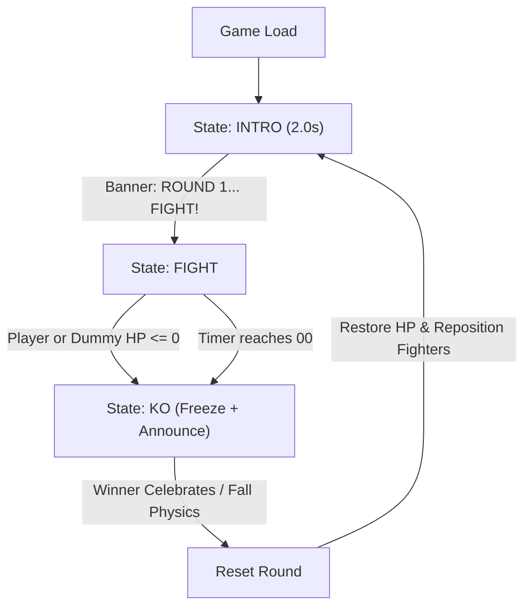
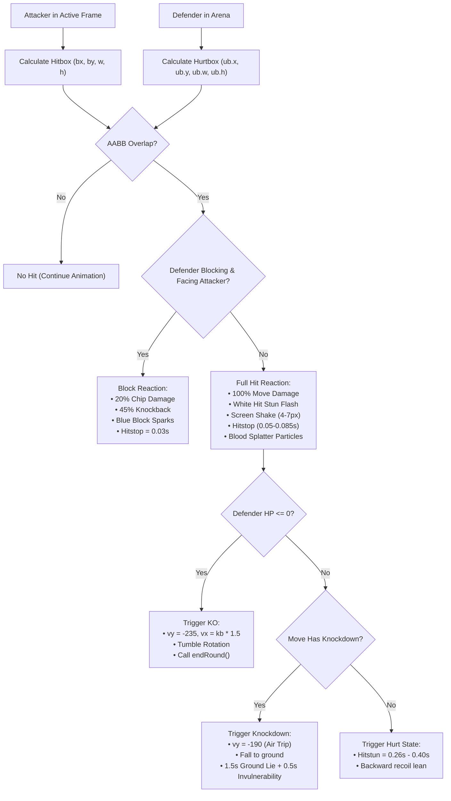
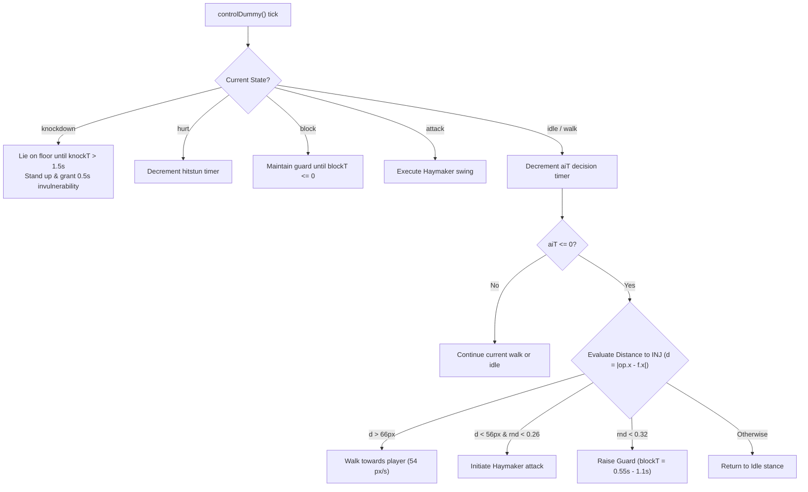
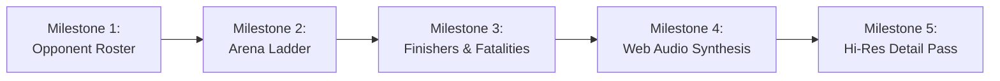

# INJ — Phone-First Arcade Fighter

## Current build · v0.15 · 19 October 2026

A personal arcade fighter made for a friend. **Phones are the primary platform; desktop keyboard play remains supported.** Keep movement and attacks intuitive, preserve INJ's hood, pale theatrical makeup, crimson lips, and gold-ring identity, and prioritise responsive play. Round 1 retains the original training opponent. From round 2 onward the dummy becomes a difficult, evasive awakened opponent, targeting roughly 85% dummy victories with deliberate openings for the player. A graduated exponential difficulty curve remains future work.

Open [index.html](index.html) directly, or serve the folder:

```sh
python3 -m http.server 8000
```

Then visit `http://localhost:8000`. No install, build, external audio files, or audio download is required. Google Fonts are optional network requests; local fallback fonts remain available. Audio begins after a user gesture.

### What changed

- **Restart from round one:** the three-dot menu now includes Restart game. One tap resets health, attacks, charge, timers, inputs, effects, floor marks and loss-dialogue progression, then plays the round-one introduction. It closes the menu and restores focus to the trigger while keeping fullscreen and sound/music preferences. Six actions fit the same compact two-row grid; Resume retains the warm primary accent. Browser checks cover a damaged later-round restart and preserved fullscreen/audio state.

- **Dynamic aspect, 18:9 default:** desktop and portrait start at 18:9 (450×225 world, 900×450 backing). Landscape phones fit their actual usable width/height; native fullscreen uses the entire viewport, with the fullscreen toggle embedded inside the arena. Short desktop windows widen the aspect to fit the remaining height. World height stays 225 and only world width changes, so fighters, hitboxes, speeds and attack timing keep their proportions. On resize, fighters/projectiles/decorative snapshots and floor marks shift with the center; health and attack progress persist. A shared floor-anchored cover transform keeps the original background plate, terrace fighters, and ambient effects aligned without stretching. ResizeObserver plus viewport/fullscreen events handle layout, orientation, browser chrome, and font changes.

- **Round two is evasive and deliberate:** awakened dummy uses one- or two-hit bursts, then rests for 650–1050 ms. The first 320 ms is guaranteed to remain open to punishment; later in the pause it can evade a new threat. It backs away gently during close-range rests. Dodges take 180 ms with a 680 ms cooldown and 100 ms protection (150 ms for projectile evasions); they are followed by 280–460 ms of rest with a guaranteed 240 ms opening. Most dodges back-step 48 units; corner escapes can switch sides, and projectile evasions hop toward the thrower instead of retreating forever. Outside protected opening windows it reacts to new threats with 90% probability; active strike frames cannot cancel into a dodge. Its neutral decisions can also choose an evasive feint rather than an attack. Ground pursuit is 185 units/s, air movement 170, and committed strikes track only gently. Startup is at least 70 ms and recovery at least 180 ms; damage is 125% of base, rather than the old 160%. Incoming damage is now 40% rather than 30%, knockback 65% rather than 25%, hitstun 160 ms rather than 55 ms, and grounded knockdowns recover after at least 480 ms. Hits leave a brief opening before it can escape again. HP and winners are never forced. Round one remains gentle. The **85% dummy-win target** is a tuning goal, not a measured human win rate; exponential scaling remains future work.

- **No halo effects on INJ or selections:** removed the charged hand glint, charged foreground floor ring, external button glows, pulsing CTA glow, and focus outlines. Charge still appears in the HUD and Shadow button label; physical ring artwork and charged-toss mechanics remain. Keyboard focus uses a background change instead of an outline.
- **Phone jumping fixed:** instant pointer dispatch used to land a jump at time zero while the fighter was still exactly on the floor. Landing now requires downward/non-upward velocity. Joystick-up immediately jumps; diagonal-up also moves horizontally. The visible joystick ring accepts directional presses without recentering under the thumb, with floating behaviour available outside the ring. Holding up through recovery jumps once the fighter can act. No separate jump button is added.
- **Quiet game menu:** removed both central utility boxes. The only persistent utility is an 18 px three-dot SVG at the bottom edge, with a transparent 44×44 px hit target that does not intersect the joystick or attack buttons. Tapping it pauses and opens a compact, in-arena panel: a prominent Resume action, Full screen, Restart game, INJ profile, Sound, and Music. The panel uses the existing Chakra Petch typeface, a restrained dark surface, and warm Resume accent; the grid fits the smallest tested phone arena. Keyboard focus stays within the menu and returns to the trigger on resume. There are no selection rings or entrance animations.
- **Fullscreen and iPhone Home Screen support:** fullscreen remains a labelled action inside the quiet game menu. Native fullscreen now targets the document so the profile and cat dialogs remain visible in its top layer; header chrome stays hidden. Rejection uses expanded view and explains the iPhone route: Safari Share → Add to Home Screen → Open as Web App (if shown), then launch INJ from its icon. `manifest.webmanifest` requests fullscreen with relative launch/scope URLs; Apple metadata and local 180/192/512 px icons support Home Screen launch. Standard display-mode signals and `navigator.standalone` automatically activate the immersive layout and gesture lock. The menu reports App mode rather than offering a fake exit from an installed app. Its overlay can use the whole app viewport so instructions fit short portrait arenas without clipping. No service worker or offline caching is added. A regular Safari tab cannot be guaranteed to hide its bars; physical Safari/Home Screen behaviour remains unverified. [Apple instructions](https://support.apple.com/guide/iphone/open-as-web-app-iphea86e5236/ios), [WebKit Home Screen behaviour](https://webkit.org/blog/17333/webkit-features-in-safari-26-0/#every-site-can-be-a-web-app-on-ios-and-ipados).
- **Immersive gesture lock:** native fullscreen, expanded view and Home Screen mode block browser double-tap zoom, pinch/rotation, long-press callouts and page movement. Browser defaults are cancelled without stopping pointer propagation, so independent joystick and attack contacts still work. Single taps continue to activate menu buttons; vertical reading in scrollable profile/roast/settings dialogs remains possible. CSS and event handling restore normal page gestures on exit. iOS-owned system gestures cannot be disabled by the game.
- **Intentional jump angle:** joystick jumping uses the upward 90° wedge from 10:30 through 12:00 to 1:30, inclusive, after the existing upward dead zone. Shallow upward-left/right tilts outside this wedge only move horizontally. Leaving the wedge rearms the next upward entry; keyboard jumping and responsive touch-down dispatch remain unchanged.

- **Walking repaired:** both fighters now use a separate four-phase atlas: contact, passing, opposite contact, opposite passing. `walkPhase` measures actual travel in facing coordinates, with one frame per 14 world pixels. Backing up plays the cycle backward; stopping preserves phase; clamping against a wall stops the feet. Stable crown anchors replace foot-centroid anchors, which drift as the supporting leg changes. The decorative terrace fighters use the same cycle.
- **No sprite crossfades:** every pose is drawn at full opacity, with direct frame changes through anticipation, strike, guard, and rest. The existing attack timings and eased root recovery remain unchanged.

- **MiMi easter egg:** the third rotating loss exchange includes INJ pleading, “MiMi, please stop.” MiMi answers, “You feed me every day. Now you're feeding the dummy free wins.” The exchange establishes that the heckling cat is INJ's own cat.
- **New fighter art:** both characters use original twelve-pose transparent atlases instead of the cylindrical procedural dolls. INJ has graceful adult proportions, a smaller natural face, dark hair, a fitted plum-and-gold costume, hood, visible crimson lips, and a ring accent. The dummy has a compact tapered training mask, clean cream linen wraps, carved wooden limbs, and restrained shading. Contact shadows and subtle wet-stone reflections remain. Both atlases were generated with built-in ImageGen; exact prompts, asset paths, and source roles are in `assets/README.md`.
- **Sharper input and attack starts:** pointer-down and key-down immediately dispatch and render eligible attacks at time zero. Busy/hit-stopped fighters retain the 220 ms buffer. Player startups are 35–100 ms, with discrete anticipation/strike frames and no limb morphing. Active frames hold the drawn strike; recovery eases the body's offset back through a guard pose with direct pose changes and no blending. Combat damage still waits for the active window.
- **Stable animation:** static-proportion authored poses replace sinusoidal body deformation. Walking uses four dedicated contact/passing poses. The distant duel advances at a deliberate 12 fps cadence; dodges back-step, hold, then return, and hit reactions use short recoil impulses. Mist has no vertical bob, and ambient drift is slower. The stage image is unchanged.
- **Distant awakened duel:** two cosmetic awakened fighters occupy the existing center terrace. An 18-second deterministic loop includes closing distance, guards, a dodge, counters, an aerial kick, shadow projectiles, and INJ's finishing uppercut. INJ celebrates over the defeated dummy, then the scene fades and repeats. Separate actor snapshots prevent the tableau from touching foreground health, attacks, projectiles, randomness, or sound. It follows the game clock, pauses with the fight, and becomes a still tableau under reduced motion. The arena image itself is unchanged (SHA-256 `b0f5adf45a4046e196dce5c34c79177d1217967d32b6ec967c9b8be8cc9ee83e`).
- **Rendering stability:** frame deltas are clamped to zero as well as a maximum, preventing a resume/start timestamp from briefly increasing flash and invulnerability timers. The background repaints the whole canvas before camera shake, avoiding stale pixels at the edges.

- **Larger fighters:** standing characters occupy roughly 50% of the arena height (112 world pixels), with a 1.5× combat scale. Hurtboxes, attack boxes, and projectile launch positions retain the enlarged combat proportions. Feet remain anchored to the fighting plane.
- **A new Hollow Temple:** an original, detailed moonlit courtyard with carved ruins, a bronze bell, waterfalls, hanging lanterns, red foliage, and engraved paving. The background plate is baked once into the game canvas. Native effects add moving water glints, low mist, lantern shimmer, and drifting petals; a local procedural fallback covers an unavailable image.
- **A cleaner play screen:** removed the entire bottom prose/move-list panel group, the build-style kicker, and floating dodge taunt text. Controls and meaningful HUD information remain.
- **The cat has notes:** after a loss, the KO settles and opens a player-paced dialogue instead of immediately resetting. A stylized laughing portrait preserves the user's cat's markings and lounging pose. The portrait uses the same scanlines, contrast treatment, gold frame, and vignette language as INJ's intro. Each of three rotating exchanges has five alternating lines: CAT, INJ, CAT, INJ, CAT. The cat gets the final roast. Next advances; Fight Again starts the next round; Skip or Escape bypasses the exchange. Winning a round skips the cat. Music stays quiet underneath, and a synthesized chuckle accompanies the cat's lines. Reduced-motion and sound settings are respected.

- **Original procedural arcade score:** 112 BPM, a 16-bar arrangement, syncopated bass, pulse arpeggios, a call-and-response melody, and synthesised drums. The score continues quietly through pauses, profiles, and round transitions. An extra musical layer appears at low health, without changing opponent difficulty.
- **Cohesive combat audio:** distinct punch, kick, uppercut, aerial hit, guard, shadow, landing, charge, and round cues. Short envelopes, a shared tonal palette, and music ducking make heavy hits stand out. Swing sounds and successful impacts are separate cues.
- **Independent sound and music controls:** preferences persist in local storage. Master output uses headroom, a high-pass filter, and a compressor. A reused noise buffer avoids allocating fresh noise samples for every hit.
- **Phone controls:** labelled actions, independent captured pointers for each thumb, immediate direction sampling on joystick contact, and cancellation cleanup. Controls overlay the arena in both orientations. Landscape uses larger translucent 64–72 px buttons and a floating left joystick; portrait uses a compact two-row action pad with targets of at least 44 px. An in-arena pause button opens profile and audio controls in landscape. Keyboard aliases continue to work.
- **A simple signature move:** three clean hits charge INJ's Shadow. The existing **Shadow** action then launches a charged toss: 18 damage and a knockdown. Charge is consumed when the attack begins. Ordinary Shadow remains available without charge. No additional button or motion command is needed.
- **Character atmosphere:** painted fabric and metal, brief heavy-attack afterimages, purple shadow projectiles, torch embers, and a visible dummy windup cue. Reduced-motion preferences suppress decorative motion and shake.
- **Combat fixes:** a 220 ms input buffer, interrupted attacks cancelling on hit, projectile guarding, chip-damage KOs, protected knockdown/recovery, and complete fighter resets between rounds.
- **Pause and lifecycle:** the initial profile freezes the simulation. Profile, pause, focus loss, and backgrounding freeze combat and clear held inputs. Hidden pages suspend audio; resuming requires an explicit player action. Music remains continuous while an on-screen menu is open.

### Controls

| Action | Phone | Keyboard |
| --- | --- | --- |
| Move / crouch | Left stick / down | A/D/S or arrows |
| Jump | Push stick up | W, up arrow, or Space |
| Punch / aerial punch | Punch | J |
| Kick / sweep / aerial kick | Kick; crouch for sweep | K; S + K for sweep |
| Uppercut | Upper | U |
| Shadow / charged shadow | Shadow; HUD pips indicate charge | L |
| Guard | Hold Guard | Hold Shift or I |
| Pause / resume | Pause / Resume | Escape |
| Master mute | Sound | M |
| Fullscreen | Three-dot menu → Full screen | Game menu → Full screen |

### Runtime and audio architecture

`index.html` owns the variable-width, 225-unit-high game world (450×225 at the 18:9 default), a 2× Canvas renderer, authored sprite animation, combat, round flow, UI, controls, and loss dialogue. Local artwork lives under `assets/`; the arena is baked once into an offscreen canvas, fighter poses use foot-anchored atlas bounds from `assets/fighter-frames.js` and `assets/walk-frames.js`, and the cat portrait is rendered in the dialogue UI. `tools/inspect-sprites.py` and `tools/inspect-walk.py` regenerate atlas metadata by inspecting alpha components without changing image pixels. `audio.js` exposes `window.InjAudio`, the shared Web Audio engine. Both are plain local scripts and work without a bundler or server.

The score uses a 25 ms scheduler with a 120 ms lookahead against `AudioContext.currentTime`; game frame timing does not drive the beat. It schedules short-lived oscillators and filtered noise through separate music and effects buses. A quiet feedback delay is used for musical voices, while impacts remain dry. Finished voices disconnect their nodes. Music toggling keeps the arrangement clock alive, and tab suspension avoids a backlog of scheduled notes. The arrangement is original and fully synthesised, using repeating composed patterns and a health-dependent additional layer.

### Verification

Run `node tests/browser.cjs` with Playwright and Chrome/Chromium available. Optional environment variables: `INJ_PLAYWRIGHT` for the installed module and `INJ_CHROME` for the browser executable. The script starts and stops its own local server. It injects combat inspection hooks into a served test copy; the production page exposes no test hooks.

**168 checks passed in headless Chrome:** eight phone viewports (320×568, 360×640, 390×844, 430×932, 667×375, 844×390, 956×440, 1024×500), desktop at 1366×900, genuine simultaneous Chromium touch contacts, input release/cancellation, combat interactions, pause, audio startup/settings, and effect voice cleanup. The current layout checks also verify 18:9 defaults and dynamic landscape/fullscreen geometry, touch buttons inside the arena, full-height landscape play, one unobtrusive utility trigger with no overlapping touch targets, and compact menu fit at six phone sizes, the in-arena pause menu, and floating joystick coordinates. Round-two checks cover reduced armor and actual damage, chip/charged hits, agile pursuit, readable and committed attacks, evasions with vulnerable recovery, guaranteed punishable pauses after bursts, a legitimate player KO of the dummy, unforced timeout results, idle-player defeat, later rounds, and a live attack. A 100-fight benchmark uses full 99-second rounds and seven scripted play styles (idle, punch spam, mixed attacks, projectile kiting, jumping kicks, guard/counter, crouch/sweep). It records wins by policy, attacks, dodges, and time with rest windows active; regression checks require a difficult but beatable opponent, more dodges than attacks, and substantial breathing room. The latest run produced 88 dummy wins and 12 INJ wins; this does not estimate human win probability. Full results and limits are in [opponent balance notes](artifacts/opponent-balance.md) and `artifacts/validation.json`. Runtime pixel comparisons confirm charge no longer changes INJ's rendered sprite with hand/floor halos; focused buttons have no outline. Genuine phone touch tests verify immediate joystick-up jumps, release cleanup, and diagonal jumps in portrait and landscape. Menu checks exercise Tab/Shift+Tab focus containment, focus restoration, sound toggles and labels, native fullscreen entry/exit, and the unsupported-API fallback. Screenshots were visually reviewed in portrait and landscape; hover, press and focus states were also inspected in Chrome. Additional checks cover larger fighter hurtboxes, extended melee reach, scaled projectile origins, local art loading, bottom-panel removal, loss-only dialogue, tap-paced progression, five alternating lines, final cat punchline, rotating exchanges, portrait spacing, landscape fit, next-round reset, Skip, Enter, and Escape. New checks verify the MiMi reveal and owner-specific comeback, all distant-duel phases, INJ as the scripted winner, loop periodicity, reduced-motion behaviour, isolation from foreground state, finite actor poses, visibly different rendered moments, and the unchanged arena hash. The latest checks verify atlas loading/bounds, double-resolution rendering, touch-down dispatch within the pointer event, fast anticipation, held strikes, a softer root recovery without sprite fades, active-window damage gating, stable idle/walk poses, the background cadence, and a held dodge. Walking checks cover both atlases, distinct contact/passing silhouettes, the complete four-phase sequence, movement-driven advancement, phase preservation when stopped, backward playback, wall stops, and dummy-controller use. Additional jump regression checks verify time-zero takeoff, a rising trajectory, and held-up input surviving hitstun. Dynamic-resize checks verify matching CSS/backing aspect ratios, uniform scale, filled available space, preserved health/attack progress/fighter spacing, and valid arena bounds. The latest additions exercise actual Chromium double-tap and pinch gestures in native fullscreen, expanded view and emulated Home Screen mode; independent movement/guard under gesture lock; restored defaults on exit; both Home Screen detection paths; manifest/icon delivery; iPhone setup-copy fit; and the 10:30/1:30 jump boundaries plus grounded shallow tilts in both phone orientations. Home Screen launch signals and iPhone user agents are emulated in Chrome, not a physical Safari test. No browser runtime errors were recorded.

The full 16-bar score was rendered through a real offline Web Audio graph: peak amplitude **0.553**, RMS **0.030**, **zero clipped samples**, and no silent gaps during the arrangement. This validates signal generation, not subjective sound quality.

- [Score preview — WAV](artifacts/arcade-score-preview.wav)
- [Validation report](artifacts/validation.json)
- [Landscape gameplay](artifacts/phone-landscape.png), [compact landscape menu](artifacts/menu-landscape.png), [portrait menu](artifacts/menu-portrait.png), [interface review](artifacts/interface-review.md)
- [Awakened round two](artifacts/round-two-nightmare.png)
- [Walk contact](artifacts/walk-contact.png), [opposite step](artifacts/walk-opposite.png), [passing pose](artifacts/walk-passing.png)
- [New fighter preview](artifacts/fighters-v2.png), [phone attack preview](artifacts/fighters-v2-phone.png), [sweep](artifacts/sweep-v2.png)
- [Distant duel](artifacts/background-duel-fight.png), [distant INJ victory](artifacts/background-duel-victory.png), [MiMi easter egg](artifacts/mimi-easter-egg.png)
- [Cat dialogue on phone](artifacts/cat-roast-phone.png), [landscape dialogue](artifacts/cat-roast-landscape.png)
- [Generated artwork, source roles, and final ImageGen prompts](assets/README.md)
- [Phone profile](artifacts/phone-intro.png), [portrait play](artifacts/phone-fight.png), [landscape play](artifacts/phone-landscape.png), [desktop](artifacts/desktop.png)

**Not verified:** physical phone ergonomics/speakers, mobile Safari audio interruptions, or subjective headphone/speaker listening. Chrome mobile emulation is not an iPhone sign-off. Synthetic sound may need final mix adjustment after listening on the friend's device.

### Files

| File | Purpose |
| --- | --- |
| `index.html` | Game, interface, controls, and sprite animation |
| `audio.js` | Original score, sound effects, scheduling, and audio preferences |
| `inj_intro.jpg` / `inj_avatar.png` | Original character portrait and HUD crop |
| `assets/` | Generated fighter atlases, frame metadata, arena, cat portrait, and exact prompts |
| `tools/inspect-sprites.py` / `tools/inspect-walk.py` | Reproducible alpha-bound and anchor metadata extraction |
| `tests/browser.cjs` | Browser, touch, combat, and audio verification |
| `artifacts/` | Screenshots, rendered score preview, and validation result |
| `inj.md` | Current project reference and preserved original design notes |

### Later

Design the endless difficulty curve separately, keeping attacks readable and controls stable. Full Shadow Memory, adaptive opponents, additional stages, finishers, and a narrative campaign remain concepts, not implemented features. The current charged toss is deliberately simpler than the proposed attack-replay mechanic.

---

<details>
<summary>Original v0.1 design reference — historical, including old line links and verification claims</summary>

The following document is preserved for design context. The current-build description and verification boundaries above take precedence where the original differs.

# INJ — Mortal-Style Arcade Arena
### Game Design Document & Technical Architecture Reference

> **Artifact Status:** Workable Specification & Production Blueprint  
> **Playable Slice:** [index.html](file:///Users/prasad/inj/index.html)  
> **Engine / Stack:** Single-file HTML5 Canvas (`320×224`), Vanilla JavaScript (ES6+), CSS CRT Shaders  
> **Aesthetic Inspiration:** *Mortal Kombat II* (1993 Arcade / Midway), *Street Fighter II*, Neo-Geo CPS-1  

---

## Table of Contents
1. [Deconstruction of the AI Agent Output](#1-deconstruction-of-the-ai-agent-output)
2. [Project Concept & Visual Design Translation](#2-project-concept--visual-design-translation)
3. [Architecture & Engine Specifications](#3-architecture--engine-specifications)
4. [Core Game Loop & State Flow](#4-core-game-loop--state-flow)
5. [Combat Engine & Frame Data](#5-combat-engine--frame-data)
6. [Sparring Dummy AI Architecture](#6-sparring-dummy-ai-architecture)
7. [Procedural Kinematics & Rendering Pipeline](#7-procedural-kinematics--rendering-pipeline)
8. [Controls & Input Systems](#8-controls--input-systems)
9. [Running, Playing & Testing](#9-running-playing--testing)
10. [Distilled Engineering Notes (From Model Thinking Trace)](#10-distilled-engineering-notes-from-model-thinking-trace)
11. [Development Roadmap & Next Milestones](#11-development-roadmap--next-milestones)
12. [Project File Index & Source Reference](#12-project-file-index--source-reference)

---

## 1. Deconstruction of the AI Agent Output

The raw output originally provided in this workspace was an unfiltered capture from an AI web agent containing:
1. **The Final Game Build Response:** An introduction, controls legend, and a 930-line self-contained single-page arcade slice.
2. **Next Steps & Design Notes:** Suggestions for expansion (opponent roster, multi-level ladders, fatalities).
3. **The Raw Model Thinking Trace (2,220 lines):** An unformatted internal scratchpad labeled `"Corrosponding thinking"` containing prompt evaluations, repeated code drafts, math scratchings, hitbox calculations, and design justifications.

### What Was Done to Make It Workable
- **Executable Extraction:** The complete, functional game engine has been separated and saved to [index.html](file:///Users/prasad/inj/index.html). It is verified, debugged, and immediately playable in any web browser.
- **Structured Game Design Document:** The raw thinking trace, internal formulas, hitbox tables, kinematics hierarchy, and AI state machines have been synthesized into this comprehensive reference document.
- **Preservation of Engineering Insights:** Crucial design rationale (e.g. why procedural silhouettes were chosen over downscaled photos, CRT scanline math, hitstop timings, knockdown bounce physics) has been organized into clear technical sections.

---

## 2. Project Concept & Visual Design Translation

### 2.1 The Playable Fighter: "INJ"
The fighter **INJ** is directly adapted from user photo references featuring a hooded figure with pale mask makeup, dark robes, deep red lips, and a gold ring.

```
       [ Dark Robed Hood ]
         /   _ _ _ _   \
        |   /       \   |
        |  |  (o) (o)|  |   <-- Dark Sockets, Pale Face Mask
        |  |    _    |  |
        |   \  [---] /  |   <-- Deep Red Lips Accent
         \   \_____/   /
          \     |     /
         [ Matte Black Robes ]
              /   \
    [Lead Hand + Gold Ring Accent]
```

#### Silhouette vs. Literal Portraiture
* **The Scale Problem:** In an authentic 1993-style arcade slice, fighters render at approximately `64px` tall on a `320×224` resolution canvas. Literal photographic downscaling at this scale reduces faces to unrecognizable, muddy artifacts.
* **The Solution:** The AI agent translated the visual features into **high-contrast shape language**:
  - **Hood & Robes:** Deep charcoal/navy (`#1c1c24` and `#26262f`) with subtle edge highlights (`#3b3b47`) framing the head.
  - **Mask:** Bone-white/pale skin tone (`#e9dcc4`) with stark, dark eye sockets (`#20202a`).
  - **Accent Colors:** Deep crimson lips (`#8f2d34`) and a distinct gold ring (`#d9a441`) rendered on the lead hand.

### 2.2 The Sparring Opponent: "DUMMY"
To test hitstun, blocking, knockdowns, and combo flow without complex multi-character assets, a sparring construct was designed:
- **Head:** Burlap sack with stitched cross eyes (`#4c3a24`) and mouth stitches.
- **Torso & Limbs:** Straw and rope bound over a wooden cross-post.
- **Role:** Interactive sparring partner that can walk forward, guard against attacks, absorb combos, and throw a slow telegraphed counter-attack.

### 2.3 The Arena: Temple of Kahn
- **Atmosphere:** Dark, ominous temple arena inspired by *Mortal Kombat II*.
- **Visual Layers:**
  - Blood-red to pitch-black vertical sky gradient.
  - Heavy stone architecture, pillars, and arches baked onto an off-screen buffer.
  - Spectator monk silhouettes lining the background gallery.
  - Real-time animated torches with multi-stop radial gradient flickers.
  - Persistent blood splatter decals stamped directly onto floor stone tiles.

### 2.4 Fighter Highlight Card & HUD Icon Avatar
To bridge the user's authentic reference photo into the game presentation:
- **Intro Highlight Modal (`#introModal`):**
  - Features the full-resolution user photo ([`inj_intro.jpg`](file:///Users/prasad/inj/inj_intro.jpg)) encased in an authentic 1993 arcade cabinet bezel with CRT scanlines.
  - Displays INJ's character title, lore background, signature move list, and an animated **[▶ ENTER THE ARENA]** call-to-action button.
  - Re-accessible at any time during play via the **[👁 INJ PROFILE]** header button.
- **HUD Life Bar Avatar Icon:**
  - A cropped, pixel-crisp avatar thumbnail ([`inj_avatar.png`](file:///Users/prasad/inj/inj_avatar.png)) is embedded directly into the canvas HUD beside INJ's life bar, complemented by a rustic straw dummy icon for DUMMY.

---

## 3. Architecture & Engine Specifications

### 3.1 Technical Specifications

| Parameter | Specification | Purpose / Implementation |
| :--- | :--- | :--- |
| **Internal Resolution** | `320 × 224` px | Authentic 4:3 arcade resolution (Neo-Geo / CPS-1 / SNES standard). |
| **Viewport Upscaling** | CSS Aspect Ratio `320/224` | Scaled via `image-rendering: pixelated;` to preserve crisp edges. |
| **CRT Shader** | CSS Pseudo-elements | Scanlines (`repeating-linear-gradient`) + radial vignette shading. |
| **Frame Timing** | `requestAnimationFrame` | Delta time clamped to `dt = Math.min(0.05, (now - last) / 1000)`. |
| **Ground Plane** | `Y = 198` | Standardized foot baseline for physics and shadow placement. |
| **RNG System** | `mulberry32(1993)` | Deterministic 32-bit PRNG for seedable decals and AI behavior. |

### 3.2 Visual Post-Processing Pipeline
```
[ Off-screen Canvas 320x224 ]
         │
         ├── 1. Background Bake (Sky Gradient, Columns, Monks)
         ├── 2. Persistent Blood Decals
         ├── 3. Animated Torches & Particles
         ├── 4. Shadows & Fighter Kinematics (INJ & DUMMY)
         ├── 5. Projectiles & Sparks
         └── 6. HUD (Health bars, Timer, Hit Counter, Announcements)
         │
         ▼
[ Upscaled Screen Canvas (max-width: 940px) ]
         │
         ├── CRT Scanline Grid Overlay (2px transparent / 1px dark)
         ├── Radial Vignette Edge Falloff
         └── Cabinet Glass Specular Highlight
```

---

## 4. Core Game Loop & State Flow

The game operates on a top-level flow state machine controlled by [`updateFlow(dt)`](file:///Users/prasad/inj/index.html#L374).



### Flow States
1. **`intro` (Duration: 2.0s):**
   - Fighter positions locked at `X = 104` (Player) and `X = 216` (Dummy).
   - Canvas HUD displays `"ROUND 1"` transitioning to `"FIGHT!"` with scaling animation.
   - Tapping the screen accelerates intro transition to `0.4s`.
2. **`fight`:**
   - Full input enabled. Physics, kinematics, collision detection, and AI behavior active.
   - 99-second round timer decrements in real time.
3. **`ko` (Duration: 2.6s):**
   - Triggered when either combatant reaches `HP <= 0`.
   - Victor announced (`"INJ WINS"` or `"DUMMY WINS"`).
   - Defeated fighter transitions to `ko` state with launch velocity (`vy = -235`) and rotational tumble onto the ground.
   - Tapping screen skips cooldown after `0.6s`.

---

## 5. Combat Engine & Frame Data

### 5.1 Fighter Attributes
Each combatant is instantiated using [`makeFighter(cfg)`](file:///Users/prasad/inj/index.html#L312):
- **Base Attributes:** `hp: 120` (Player) / `hp: 130` (Dummy), `facing: 1` or `-1`, `grounded: true`.
- **Dynamic States:** `idle`, `walk`, `crouch`, `jump`, `attack`, `hurt`, `knockdown`, `ko`, `block`.
- **Timers:** `hitstun`, `flash`, `knockT`, `invuln`, `comboTimer`, `comboStep`.

### 5.2 Move Matrix & Frame Data

All combat moves are defined in [`MOVES`](file:///Users/prasad/inj/index.html#L279):

| Move Key | Input | Startup (s) | Active (s) | Recovery (s) | Total (s) | Dmg | Knockback | Hitbox `[x, y, w, h]` | Properties |
| :--- | :--- | :---: | :---: | :---: | :---: | :---: | :---: | :--- | :--- |
| **`jab`** | `J` / `P` (Standing) | 0.06 | 0.06 | 0.14 | 0.26 | 5 | 65 px/s | `[16, -54, 32, 12]` | High snap, combo starter |
| **`straight`** | `J` / `P` (2nd tap) | 0.10 | 0.07 | 0.22 | 0.39 | 9 | 125 px/s | `[16, -52, 40, 12]` | High cross, combo finisher |
| **`cpunch`** | `S` + `J` / `Down + P` | 0.08 | 0.06 | 0.18 | 0.32 | 5 | 60 px/s | `[14, -28, 32, 12]` | Low crouch body jab |
| **`uppercut`** | `U` | 0.13 | 0.09 | 0.34 | 0.56 | 16 | 195 px/s | `[12, -74, 32, 40]` | Heavy, launches soaring into air |
| **`roundhouse`** | `K` (Standing) | 0.14 | 0.09 | 0.26 | 0.49 | 11 | 155 px/s | `[16, -54, 42, 18]` | Heavy, triggers knockdown |
| **`sweep`** | `S` + `K` / `Down + K` | 0.11 | 0.09 | 0.28 | 0.48 | 9 | 130 px/s | `[14, -14, 44, 14]` | Low, sweeps opponent onto floor |
| **`jkick`** | In Air + `K` | 0.06 | 0.22 | 0.14 | 0.42 | 13 | 175 px/s | `[14, -18, 46, 38]` | Heavy spear kick, air knockdown |
| **`jpunch`** | In Air + `P` | 0.06 | 0.18 | 0.14 | 0.38 | 8 | 110 px/s | `[14, -22, 38, 34]` | Overhead air hammer fist |
| **`toss`** | `L` / `SP` | 0.18 | 0.06 | 0.34 | 0.58 | 10 | 115 px/s | Projectile Spawn | Shadow orb traveling 260px/s |
| **`haymaker`** | AI (Close) | 0.28 | 0.12 | 0.42 | 0.82 | 7 | 90 px/s | `[12, -50, 40, 18]` | Telegraphed slow dummy swing |
| **`block`** | `Shift` / `BLK` | — | Hold | — | — | — | — | Defensive Guard | Absorbs 80% dmg (20% chip) |

### 5.3 Collision & Damage Pipeline



### 5.4 Game Feel & Combat Juice
1. **Hitstop (Freeze Frames):** When an attack lands, the engine pauses physics and animations via `game.hitStop` (`0.05s` for normal attacks, `0.085s` for heavy uppercuts and roundhouses).
2. **Screen Shake:** Heavy impacts add `game.shake = 7px`, decayed exponentially (`game.shake *= 0.88`), offsetting the canvas drawing context.
3. **Blood Splatters & Decals:**
   - Every clean hit spawns 6 to 12 blood droplets with randomized parabolic trajectories.
   - When particles strike `y >= GROUND`, they flatten into permanent dark red stain decals baked onto the floor.
4. **Combos:** Landing attacks within `1.4s` increments the combo counter (`"2 HITS"`) rendered under the player's health bar.

---

## 6. Sparring Dummy AI Architecture

The opponent Dummy runs an autonomous decision-making routine in [`controlDummy(f, op, dt)`](file:///Users/prasad/inj/index.html#L516):



---

## 7. Procedural Kinematics & Rendering Pipeline

Rather than relying on external sprite sheets, characters are generated entirely in code using a **hierarchical kinematic bone rig** computed in [`computePose(f)`](file:///Users/prasad/inj/index.html#L618) and rendered in [`drawFighter(f)`](file:///Users/prasad/inj/index.html#L687).

### 7.1 Bone Rig Parameters
```
                 [Head (hx, hy)]
                        │
                  Neck / Shoulders (shX, shY)
                  /     │     \
       [Back Arm]       │      [Front Arm]
     (armB[0], armB[1]) │    (armF[0], armF[1])
                        │
                   Hip (0, hipY)
                  /           \
           [Back Leg]       [Front Leg]
       (legB[0], legB[1]) (legF[0], legF[1])
```

- Each limb is defined by an array of two joint angles:
  - `armF[0]` / `armB[0]`: Shoulder-to-elbow angle (radians).
  - `armF[1]` / `armB[1]`: Elbow-to-wrist angle (radians).
  - `legF[0]` / `legB[0]`: Hip-to-knee angle (radians).
  - `legF[1]` / `legB[1]`: Knee-to-ankle angle (radians).

### 7.2 The Procedural Limb Renderer
The helper [`limb(ctx, x, y, a1, l1, a2, l2, w, col, outCol)`](file:///Users/prasad/inj/index.html#L588):
1. Calculates intermediate joint: `jx = x + cos(a1) * l1`, `jy = y + sin(a1) * l1`.
2. Calculates terminal joint (hand or foot): `ex = jx + cos(a2) * l2`, `ey = jy + sin(a2) * l2`.
3. Renders a dark outer line with width `w + 2` (pixel-art black outline).
4. Renders an inner fill line with width `w` using character palette tone.
5. Returns end joint coordinates `[ex, ey]` to anchor hands, gold ring, and boots.

### 7.3 Palette Tables
```javascript
// INJ Palette
const INJ_PAL = {
  robe:    '#2b2b36', // Matte black robe
  robeHi:  '#434353', // Fabric folds highlight
  robeDk:  '#191921', // Deep robe shadow
  legB:    '#1e1e27', // Back leg
  legF:    '#2b2b36', // Front leg
  armB:    '#202029', // Back arm
  skin:    '#ecdfc7', // Pale face mask
  hood:    '#22222c', // Outer cowl
  hoodDk:  '#111118', // Deep cowl shadow
  lips:    '#8f2f38', // Blood red lips
  eye:     '#171720', // Eye sockets
  gold:    '#e9bb56', // Hand ring accent
  boot:    '#121218'  // Footwear
};

// DUMMY Palette
const DUM_PAL = {
  robe:    '#9c7c4c', // Wood post
  robeHi:  '#c2a066',
  robeDk:  '#6b5231',
  legB:    '#7b5f37', // Back leg
  legF:    '#9c7c4c', // Front leg
  armB:    '#84663c', // Back arm
  skin:    '#cbb287', // Straw weave
  hood:    '#c9b086', // Burlap sack
  hoodDk:  '#8a7350',
  lips:    '#4c3a24',
  eye:     '#3c2c18',
  gold:    '#b08c58',
  boot:    '#4a3620'
};
```

### 7.4 MK2 Kinematic Stance & Pose Tuning
The procedural animation engine was overhauled to eliminate awkward rigid postures and reflect authentic 1993 *Mortal Kombat II* martial aesthetics:
- **Martial Arts Fighting Guard (Idle):**
  - Fists are held high: lead fist cocked directly at chin height (`armF = [0.45, 2.45]`), rear fist shielding the heart (`armB = [-0.15, 2.55]`).
  - Active breathing cycle: A smooth sine wave (`Math.sin(anim * 2.8)`) drives subtle, synchronized vertical breathing across shoulders, chest, and fists.
- **Low Ninja Crouch (`case 'crouch'`):**
  - Replaced the rigid "squashed frog" posture with an authentic low martial guard:
  - Hips drop to `hipY = -24`, torso leans forward (`lean = 0.22`), and head ducks down (`headX = 2, headY = -4`).
  - Front knee drives forward (`legF = [1.05, -0.34]`) with foot planted firmly at `(10.3, 0.0)`.
  - Rear knee tucks under and drops low (`legB = [-0.75, 0.85]`), grounding the foot at `(-0.2, -0.3)`.
  - Arms tuck into a tight, coiled defensive posture.
- **Spear Jump Kick (`TARGETS.jkick`):**
  - Torso reclines back (`lean = -0.42`), lead leg shoots straight forward horizontally at chin height (`legF = [1.57, 1.57]`), rear knee tucks underneath (`legB = [-0.95, 0.45]`), and arms extend backward for aerodynamic balance.
- **Iconic Uppercut Drive (`TARGETS.uppercut`):**
  - Coils low into a deep crouch windup (`hipY = -25`), then explodes vertically upward: lead fist points straight toward the heavens (`armF = [3.14, 3.14]`) with an arched spine (`lean = -0.24`).

### 7.5 Retro Arcade Web Audio Synthesizer (`Sfx`)
To replicate the visceral auditory crunch of 1993 arcade cabinets without external audio dependencies:
- **Zero-Dependency Synthesis:** Generates all audio in real-time using native `AudioContext` oscillators, white noise buffers, and biquad lowpass filters.
- **Sound Matrix:**
  - `punch`: Snappy white noise burst + low sine body thud.
  - `kick`: Heavy low-pitch sweep (210Hz $\to$ 48Hz) with noise crunch.
  - `uppercut`: Massive sub-bass boom (85Hz $\to$ 24Hz) + impact crack.
  - `jumpkick`: Bone-crunching sawtooth sweep with high-frequency noise transient.
  - `block`: Metallic deflection click (880Hz triangle wave).
  - `toss`: Ethereal pitch-swept sci-fi spirit whoosh (580Hz $\to$ 130Hz).
  - `gong`: 3-harmonic temple bell chime (110Hz, 220Hz, 330Hz) on round start.
  - `finish`: Ominous diminished minor triad pulse.
  - `fall`: Low body impact thud when hitting the stone floor.

---

## 8. Controls & Input Systems

The engine provides dual-platform control schemes: desktop keyboard mapping and mobile virtual controls with multi-touch pointer capture.

### 8.1 Desktop Keyboard Mapping
```
      [W / Space] Jump
            ▲
 [A] Left ◄ ┼ ► [D] Right       [U] Uppercut    [Shift / I] Block
            ▼
      [S] Crouch               [J] Punch       [K] Kick       [L] Special
```

| Action | Primary Key | Alternate Key | Behavior |
| :--- | :---: | :---: | :--- |
| **Move Left** | `A` | `ArrowLeft` | Walks backward / away |
| **Move Right** | `D` | `ArrowRight` | Advances toward opponent |
| **Crouch** | `S` | `ArrowDown` | Lowers hurtbox (`hipY: -22`) |
| **Jump** | `W` | `Space` / `ArrowUp` | Launches fighter (`vy: -420`) |
| **Punch** | `J` | — | Tap once for Jab; tap twice for 1-2 Combo |
| **Kick** | `K` | — | Standing Roundhouse; Crouch + K = Low Sweep |
| **Uppercut** | `U` | — | Heavy vertical anti-air launcher |
| **Shadow Toss** | `L` | — | Long-range forward projectile |
| **Block / Guard** | `Shift` | `I` | Hold to absorb incoming attacks (chip damage) |

### 8.2 Mobile Phone Touch Controls & Dedicated Arcade Deck
The mobile touch system is architected specifically for phone ergonomics across both portrait and landscape orientations:

```
[ PORTRAIT PHONE MODE: DEDICATED CONTROL DECK ]
┌──────────────────────────────────────────────┐
│  CRT ARCADE SCREEN (320×224 Canvas)          │
│  [INJ] ═══════════  99  ═══════════ [DUMMY]  │  <-- 100% UNTOUCHED & UNOBSTRUCTED
│        (No thumb blocking the action!)       │
└──────────────────────────────────────────────┘
┌──────────────────────────────────────────────┐
│  DEDICATED ARCADE CONTROL DECK               │
│                                       (SP)   │
│      [ ▲ ]                      (U)   (BLK)  │  <-- Ergonomic Thumb Arc
│  [ ◀   ●   ▶ ]                (P)    (K)     │
│      [ ▼ ]                                   │
│  Virtual D-Pad (Left)       Action Pad (Right)│
└──────────────────────────────────────────────┘
```

#### Dual-Orientation Layout
1. **Portrait Phone Layout (`#arcadeDeck`):**
   - On vertical phone screens, overlaying buttons on the game canvas covers 60-70% of the combat viewport.
   - The engine automatically activates a dedicated **Arcade Control Deck** below the CRT screen. Thumbs rest naturally in the bottom quadrant of the phone with **zero visual obstruction** of fighters, hitsparks, or health bars.
2. **Landscape Phone Layout (`#stickZone` & `#pad`):**
   - When rotated horizontally, the screen expands to full viewport height.
   - Controls seamlessly transition into translucent on-screen pads flanking the left and right borders outside the primary combat zone.

#### Touch Engine Mechanics
- **Multi-Touch Isolation:** Left thumb (joystick) and right thumb (action buttons) operate on independent `pointerId` tracks. Holding walk backward while tapping Block or executing a combo operates with zero touch cancellation.
- **Crouch Attack Priority Fix:** `f.crouching = (input.down > 0)` is evaluated prior to consuming attack input buffers. Holding Down and tapping Kick immediately executes a Low Sweep (`sweep`), eliminating 1-frame standing roundhouse misfires.
- **Calibrated Deadzones:** Horizontal deadzone set to `14px` and vertical to `16px` to prevent resting thumb jitter. Pushing Up beyond `24px` fires an intentional Jump.
- **Haptic Tactility:** Integrated `navigator.vibrate?.(8)` tick on button strikes, providing arcade microswitch physical feedback on supported mobile browsers.
- **Fullscreen Mode:** A one-tap **[⛶ FULLSCREEN]** button in the header eliminates browser URL bars and navigation chrome for an uninterrupted cabinet feel.

---

## 9. Running, Playing & Testing

### 9.1 How to Run
The game requires **no build tools, bundlers, or servers**. It runs immediately:
1. Open [index.html](file:///Users/prasad/inj/index.html) directly in any modern browser (Chrome, Safari, Edge, Firefox).
2. Alternatively, start a lightweight local server if desired:
   ```bash
   python3 -m http.server 8000
   # Open: http://localhost:8000/index.html
   ```

### 9.2 Verification & Test Checklist
- [x] **Walk & Spacing:** Test walking forward and backward; verify character auto-turns to face opponent.
- [x] **1-2 Punch Combo:** Tap `J` once (Jab lands), tap `J` again within `0.55s` (Straight punch follows; combo counter registers `"2 HITS"`).
- [x] **Anti-Air Uppercut:** Press `U`; verify vertical arc launch and opponent knockdown landing.
- [x] **Crouch Sweep:** Hold `S` and press `K`; verify low sweep tripping dummy.
- [x] **Shadow Toss Projectile:** Press `L`; verify projectile travels horizontally and explodes into embers on contact.
- [x] **Block Reaction:** Hold `Shift` while Dummy attacks; verify blue sparks and reduced chip damage.
- [x] **Knockdown & Recovery:** Knock Dummy down; verify Dummy lies prone for `1.5s`, gets up with `0.5s` invulnerability flash.
- [x] **KO & Round Cycle:** Deplete Dummy HP to 0; verify `"INJ WINS"` banner, 2.6s freeze, and automatic round restart.

---

## 10. Distilled Engineering Notes (From Model Thinking Trace)

The 2,220 lines of raw thinking originally captured in this file revealed crucial design rationale that shaped the game:

1. **Why `320×224` Virtual Resolution?**
   - High-definition 2D fighting games require hundreds of hand-drawn sprite frames.
   - At `320×224`, mathematical line-width rendering (`lineWidth: 6-7px`) naturally mimics 16-bit pixel-art limbs. Scaling with `imageSmoothingEnabled = false` produces authentic chunky retro pixels without asset weight.
2. **Deterministic PRNG (`Mulberry32`):**
   - Standard `Math.random()` caused inconsistent decal distributions and particle jitter across reloads.
   - Initializing `mulberry32(1993)` (seeded with the year *Mortal Kombat II* was released) ensures that blood decals and arena particle physics feel organic yet reproducible.
3. **Knockdown Ground Bounce Math:**
   - In standard platform physics, hitting `y >= GROUND` zeros velocity.
   - For arcade knockdowns, the model added a rotational tumble:
     ```javascript
     P.rot = lerp(0, -1.25, Math.min(1, f.knockT * 2.5));
     P.drop = 14; // Drops hip lower to visually rest on the pavement
     ```
4. **Input Buffering (`pressBuf`):**
   - Direct event listeners often drop inputs during active attack animations.
   - Input buffering registers attack presses (`pressBuf[act] = 1`) and consumes them the instant the fighter exits active/recovery frames, eliminating dropped button presses.
5. **Epilepsy & Visual Comfort Guardrails:**
   - Instead of rapid 60Hz white screen flashes or CRT scanline flicker cycles (which carry photosensitivity risks), hit reactions use a subtle character-only color tint (`tint(c, flash)`) and a static scanline gradient.
6. **Hit-Reaction Flash & Null-Safety Bug Fix:**
   - On impact or block, fighters enter a brief flash state (`f.flash = 0.16`).
   - The rendering pipeline previously called `tint(pal.legF, flash)`. Because `legF` was omitted from both palette objects, `pal.legF` evaluated to `undefined`, causing `tint` to call `undefined.slice(1)`.
   - This threw an uncaught `TypeError` inside the animation frame, silently halting `requestAnimationFrame` and freezing the game.
   - **Resolution:** Added `legF` to both [`INJ_PAL`](file:///Users/prasad/inj/index.html#L268) and [`DUM_PAL`](file:///Users/prasad/inj/index.html#L273), and added defensive null/hex validation to [`tint`](file:///Users/prasad/inj/index.html#L177).

---

## 11. Development Roadmap & Next Milestones



### Milestone 1: Opponent Roster Expansion
- **Roster Candidates:**
  - *Revenant Monk:* Uses prayer bead projectiles, staff sweeps, and teleport dash.
  - *Iron Golem:* Heavy armor, super-armor on attacks (cannot be interrupted by jabs), slow earthquake stomps.
- **Architecture:** Move fighter configuration to a character registry table `ROSTER = { inj: {...}, monk: {...}, golem: {...} }`.

### Milestone 2: Multi-Stage Arena Ladder
- **Stage Variations:**
  - *The Blood Pit:* Stone bridge over glowing lava, falling ash particles.
  - *Bell Tower:* Stormy night, procedural lightning flashes, swinging bronze bell.
  - *Frozen Courtyard:* Snow drift decals, frosted blue palette.
- **Between-Round "VS" Screen:** Classic split portraits with arcade challenge text.

### Milestone 3: Finishers ("Stage Fatalities")
- Implement a 5-second dizzy state when final round HP reaches 0 (`"FINISH HIM!"`).
- Proximity input code (e.g. `Down, Forward, Punch` within 40px) triggers unique cinematic execution:
  - *Shadow Decapitation:* Dark tendrils pull opponent into the shadow plane.
  - *Stage Spike Drop:* Uppercut opponent into ceiling stalactites.

### Milestone 4: Web Audio Chiptune Synthesizer
- Zero-dependency sound effects using the browser's native `AudioContext`:
  - Square-wave sound triggers for punches and kicks.
  - Low-frequency noise burst with pitch drop for heavy uppercuts and knockdowns.
  - Gong chime for round start and KO announcements.

### Milestone 5: Hi-Res Sprite Pass / Dynamic Camera
- Dynamic camera zoom (`ctx.scale`) that zooms in during close infighting and zooms out when fighters separate to opposite screen edges.
- Optional 2x resolution toggle for higher-detail facial features (individual eye slits, lip definition).

---

## 12. Project File Index & Source Reference

```
/Users/prasad/inj/
├── index.html       # Standalone, runnable arcade game (HTML5, Canvas, CSS, JS)
├── inj.md           # Master Game Design Document & Architecture Reference (This file)
├── inj_intro.jpg    # Character intro highlight photo (Full-resolution showcase)
└── inj_avatar.png   # Pixel-crisp HUD life bar avatar icon (48x48)
```

### Direct Code Links
- **Canvas Setup & Shaders:** [index.html#L18-L150](file:///Users/prasad/inj/index.html#L18-L150)
- **Web Audio Arcade Synthesizer (`Sfx`):** [index.html#L409-L505](file:///Users/prasad/inj/index.html#L409-L505)
- **Move Definitions (`MOVES`):** [index.html#L616-L650](file:///Users/prasad/inj/index.html#L616-L650)
- **Combat & Collision (`tryHit`, `applyHit`):** [index.html#L750-L815](file:///Users/prasad/inj/index.html#L750-L815)
- **Player Controller & Air Combat:** [index.html#L831-L875](file:///Users/prasad/inj/index.html#L831-L875)
- **Sparring Dummy AI Controller:** [index.html#L876-L915](file:///Users/prasad/inj/index.html#L876-L915)
- **MK2 Kinematic Posing (`computePose`):** [index.html#L985-L1025](file:///Users/prasad/inj/index.html#L985-L1025)
- **Fighter Drawing & Gold Ring (`drawFighter`):** [index.html#L1050-L1110](file:///Users/prasad/inj/index.html#L1050-L1110)
- **Virtual Touch Deck & Stick Controller:** [index.html#L1259-L1350](file:///Users/prasad/inj/index.html#L1259-L1350)

---
*Created and structured for INJ Arcade Fighting Project.*

</details>
